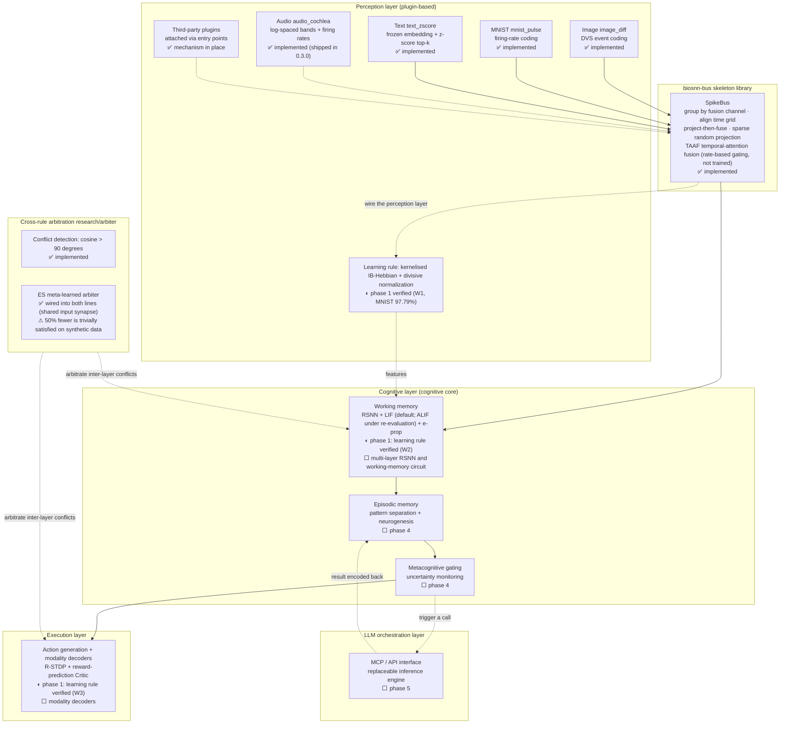

# BioSNN-Plug

**A biologically-plausible, fully multimodal spiking neural network cognitive prototype**

> **What is and isn't translated.** The documentation is available in Chinese, English and
> Japanese. The **code is not** — docstrings, inline comments and error messages are written
> in Chinese only, so a non-Chinese reader will still meet Chinese text when working with the
> library. The Japanese documentation is a machine-assisted translation that has not been
> reviewed by a native speaker; if something reads unnaturally, please open an issue.

[中文](README.md) · [日本語](README.ja.md) · [Project plan v6.2 (Chinese)](BioSNN-Plug_项目计划书_v6.2.md) · [v6.3, the revision with citation corrections (Chinese)](BioSNN-Plug_项目计划书_v6.3.md) · [Plan-vs-repo gap audit (Chinese)](BioSNN-Plug_计划书差距审计.md) · [Plugin guide](docs/plugin_guide.en.md) · [Architecture decision records](docs/adr/README.en.md)

> **How the two versions relate**: **v6.2 is the official project plan**; **v6.3** folds in the first batch of citation-provenance corrections (the list is in [`docs/references.en.md`](docs/references.en.md), "Items in the body of the project plan awaiting correction"). Cite v6.2 as the plan; reach for v6.3 when you need the corrected wording (for example the positioning of Trace Propagation or the provenance of TD-LTP).

[](https://github.com/lzmd-arch/BioSNN-Plug/actions/workflows/ci.yml)
[](LICENSE)
[](https://www.python.org/downloads/)
[](https://colab.research.google.com/github/lzmd-arch/BioSNN-Plug/blob/main/examples/quickstart_register_plugin.en.ipynb)

## Publications and deposits

[](https://doi.org/10.5281/zenodo.23429379)

| Output | Type / licence | Identifier | Status |
| :--- | :--- | :--- | :--- |
| **P2 paper**: W2 e-prop against a matched-budget BPTT control | Preprint / CC-BY-4.0 | [10.5281/zenodo.23429379](https://doi.org/10.5281/zenodo.23429379) | Published (v1.1, 2026-10-17) |
| **P4 paper**: when arbitration can be measured (synergy benchmark + protocol) | Preprint / CC-BY-4.0 | [10.5281/zenodo.23613539](https://doi.org/10.5281/zenodo.23613539) | Published (v1.0, 2026-10-24) |
| **Record A**: W2 findings and protocol snapshot | Report / Apache-2.0 | [10.5281/zenodo.23428426](https://doi.org/10.5281/zenodo.23428426) | Published (v0.2, 2026-10-17) |
| **Record C**: P4 design notes (arbiter formalisation, synergy criteria, three rulings) | Report / Apache-2.0 | [10.5281/zenodo.23603639](https://doi.org/10.5281/zenodo.23603639) | Published (v0.1, 2026-10-24) |
| **Record D**: architecture and design-decision record (plan v6.3, ADR index, four-axis frame) | Other | [10.5281/zenodo.23603642](https://doi.org/10.5281/zenodo.23603642) | Published (v0.1, 2026-10-24) |

⚠️ A deposit is an **immutable snapshot** of the moment it was made; current numbers live in this README and the [reproducibility record](docs/reproducibility.en.md).

## What this is

A research prototype testing one question: **can intelligence grow out of purely local
learning rules, and learn to extend its own boundaries by calling on external reasoning?**

Three claims are under test:

1. **No surrogate gradients** — every synaptic update is driven by local signals (kernelized IB-Hebbian in perception, e-prop in the cognitive core, R-STDP in execution);
2. **Modality plugins** — text, image and audio attach to a shared cognitive core as independent plugins; adding a modality requires no change to the existing architecture;
3. **The SNN calls the LLM autonomously** — the SNN is the cognitive subject and decides *when to act* and *what to associate*; the LLM is a replaceable inference engine responsible only for *what to generate*.

## What this is not

**Not a production framework.** No SOTA-chasing, no availability guarantees, one maintainer, no SLA on issues.

**Not a general SNN library.** Performance is not the goal; the point is to test whether a high-risk route holds up.

**Evidence, not inspiration.** Conclusions have to be reproducible from this repository; citations that cannot be verified are marked `unverified` (see the [reference list](docs/references.en.md)).

## How this relates to comparable projects

A one-glance comparison. **The evidence behind every cell, and the licence boundaries (which
project may enter a dependency, which may not be copied at all), are in
[`docs/related_projects.en.md`](docs/related_projects.en.md).**

| | Purely local learning | Modality plugins | Autonomous triggering | Continual learning | Open-source framework |
| :--- | :---: | :---: | :---: | :---: | :---: |
| **Javis** | ◐ STDP family throughout, no backprop (12 selectable); warning: **its own `iter-45` reward benchmark puts neither arm above chance** (README verbatim "neither arm reaches above-chance accuracy") | ✗ | ✗ | ✗ | ◐ Rust, but **PolyForm noncommercial** |
| **EMBER** | ◐ STDP + eligibility traces x dopamine gating | ✗ (text only) | ◐ observational, **N=1** | ✗ | ✗ no public repo |
| **MEMBRAIN** | ◐ Voja + PES | ✗ | ✗ | ◐ claims disagree with implementation | ✅ Nengo (MIT) |
| **eprop-PyTorch / ESPP** | ✅ e-prop; ESPP is a separate parallel rule | ✗ | ✗ | ✗ | ◐ code fragments, not a framework |
| **BioSNN-Plug** (this project) | ✅ all three lines accepted | ✅ four plugins (image / MNIST / text / audio) | ○ phase 5 | ○ phase 3 | ✅ `biosnn-bus` is on PyPI |

Legend: **✅ implemented, with acceptance data** · **◐ partial** (mechanism or evidence incomplete) ·
**○ roadmap only (task exists in the plan, not started)** · **✗ none**

⚠️ **Two cells in the last row are ○ rather than ✅** -- "autonomous triggering" sits in phase 5 and
"continual learning" in phase 3, and **neither is implemented yet**. The marks are kept separate
precisely so this table cannot be read as "we have already done it".

## Research positioning

"Why does intelligence emerge?" is split into four axes: **substrate** (scale, dimensionality,
synapse count), **dynamics** (global state variables that bias learning — hormones, affect,
consolidation, instinct), **organisation** (genetic pre-wiring, regionalisation, turnover,
self-proliferation) and **grounding** (physical rules, real perception, modality fidelity). If
they relate at all, the relation is **multiplicative**: any axis at zero caps the whole.

**Our bet**: leave the substrate race — it lacks neither entrants nor compute — and spend the
resources on **whether dynamics x organisation can substitute for substrate**, by building an
instrument that can measure that question. If the answer is yes, scale is not the cause of
emergence but the size a particular organisation permits.

Measurement discipline is not a slogan: preregistrations, trivial-solution checks, the machine check-list and negative verifications are all recorded in the [reproducibility record](docs/reproducibility.en.md).

## Status

| Part | Status | Last update |
| :--- | :--- | :--- |
| `biosnn-bus` skeleton library | **0.3.0 (adds the audio plugin; published to PyPI)** — plugin interface, registration and discovery, the spike bus, **TAAF temporal-attention fusion** (rate-based gating; weights computed from each stream's firing rate, **no backpropagation**); `Used in:` [Axo](https://github.com/lzmd-arch/Axo) (a shipping terminal): its standalone `axo.busd` process instantiates `SpikeBus` and calls `step()` continuously (fusion plus sparse random projection), with new memories encoded by a custom `ModalityPlugin`; the UI reads only a stdlib-written JSONL event file and never imports this library | 2026-10-18 |
| Modality plugins | **Four**: `image_diff` (DVS event coding), `mnist_pulse` (firing rates), **`text_zscore`** (frozen local embedding + z-score top-k population coding), **`audio_cochlea`** (log-band decomposition + firing rates; shipped in 0.3.0 on PyPI) | 2026-10-18 |
| Research code: three verification lines | **Phase-1 implementations complete** — W1 Hebbian perception MNIST **97.79%** (default closed-form readout; SGD readout 98.01%) ✓; W2 e-prop sequential sMNIST **0.7764** (30 epochs x 5 seeds) -> **0.8889** (**official**: **LIF** @ lr=1e-2 @ 250 epochs, converged; ALIF 0.8831 same budget as control; **matched-budget BPTT control 0.9630, 7.41 points ahead** — stated as measured: the local rule still trails backpropagation; **recipe parity, quantified**: BPTT's optimizer formulation is worth **+8.53 pp** at small learning rates (1e-3) and only **+0.88 pp** at the rate finally chosen (inside the tie band) — at the operating point the two arms are comparable recipes); learning-rate interaction swept, **LIF leads across the whole grid** ✓; W3 R-STDP CartPole median **237.8 steps** (criterion >= 200) ✓. Numbers and provenance: [reproducibility record](docs/reproducibility.en.md) | 2026-10-18 |
| **Network scale** | **256 spiking neurons** (W2); W1 adds 3,072 **rate-based** units (not spiking neurons). The plan's §2.2 cognitive core targets roughly 50,000 — **about 195x away**; see [research/README](research/README.en.md) | 2026-10-18 |
| Arbiter | **Parts in place** (`research/arbiter/`): conflict detection (cosine > 90 degrees) + ES meta-learned arbiter, **wired into two research lines** (shared input synapses). ⚠️ Only the input->hidden weight is shared, and "50% fewer conflict events" holds **trivially** on synthetic data — see that directory's README | 2026-10-24 |
| Spiking execution layer (phase three) | **Entry point, linear TD critic and the TD-LTP population critic are all in place, but none of them clears 200.** ⚠️ **Every number before 2026-10-18 is void**: training episodes were missing an environment seed, so one seed produced different trajectories. After the fix, a **10-seed comparison**: linear TD median 50.4, population default 55.0, operating point 37.1 — **all intervals overlap, all 0/10**; the three main arms are indistinguishable. The rate-based version's median of 237.8 remains the only implementation that passes. See [research/rstdp_spiking](research/rstdp_spiking/README.en.md) | 2026-10-18 |
| Cross-modal retrieval | **Ten rounds of retrieval experiments**: the original criterion (absolute R@1 50%) cannot separate "local learning works" on either dataset, and was restated as **recovery rate** (synthetic 75.2%, Flickr8k **78.7%**, full grid); Flickr8k's **front end** has its own criterion — caption content-word linear probe median AUC **0.790** (text-side self-check 1.000) | 2026-10-17 |
| Cognitive core / LLM orchestration | **Not started** — see the [project plan](BioSNN-Plug_项目计划书_v6.2.md) §七 | — |

**Phase-two success criteria, as things actually stand**:

| Criterion | Status |
| :--- | :--- |
| Plugins replace independently | ✅ Four plugins + entry points; skeleton library is on PyPI |
| TAAF fine-tuning samples < 1/10 of from-scratch | ⚠️ **The criterion dissolves under [ADR-0012](docs/adr/ADR-0012-taaf-locality-and-bus-output-contract.en.md); it is not met** — fusion weights are never trained, per the red line, so the criterion **has no referent** (no fine-tuning means no "fine-tuning sample count"). See plan revision note 27 |
| Cross-modal retrieval R@1 50%+ | ⚠️ **The original criterion (absolute 50%) was not met and has been judged non-discriminating** (the synthetic set can be satisfied by memorisation; the Flickr8k frozen front end's upper bound is 0.076). **Restated as "recovery rate" and passed**: the local rule recovers **75.2% (synthetic) / 78.7% (Flickr8k, full grid)** of the linear upper bound — see [research/retrieval](research/retrieval/README.en.md) |
| Arbiter cuts dual-rule conflict events by 50%+ | ✅ Met on a **real shared synapse** (10 -> 0, `retention` 0.3) |

Three boundaries worth stating plainly:

- **TAAF is implemented, but the default strategy is still concatenation**:
  `TemporalAttentionFusion` is a fusion strategy you **opt into** (`SpikeBus(strategy=...)`);
  the default is still plain concatenation. Warning: its attention weights are **computed from
  each path's firing rate and never trained** (rate-based gating) — that red line is pinned by
  an **AST structural assertion**, see [ADR-0012](docs/adr/ADR-0012-taaf-locality-and-bus-output-contract.en.md).
- **The perception layer may use a frozen pre-trained front end** (boundary declaration, see
  [plan section 2.3](BioSNN-Plug_项目计划书_v6.3.md)): the "purely local learning" claim covers
  **synaptic learning rules**, not **input encoders**. The test is "do the parameters enter a
  gradient", not "is the model big" — a frozen 2GB pre-trained embedding is equivalent to a
  fixed random projection here; conversely, a 100-line local encoder that trains its own
  parameters by backprop **breaks** this boundary. The text plugin's `nomic-embed-text`
  (Ollama, 768-d) is frozen.
- (Why the skeleton library is a separate package, and why it deliberately includes none of
  these things, see [ADR-0001](docs/adr/ADR-0001-skeleton-as-separate-library.en.md).)
- The skeleton library **is on PyPI**: `pip install biosnn-bus` (PyPI serves `0.3.0`, which adds the `audio_cochlea` plugin). Releases go through PyPI trusted publishing (OIDC, no stored tokens); the pipeline is in [release.yml](.github/workflows/release.yml).

## Exploration items (not in the current schedule)

Three items have been opened but **consume none of the current phase's schedule**. Each states
its activation condition; until that condition holds, it does not start. They are listed so that
"not done" and "not planned" stay distinguishable on the front page.

| Item | Home | Activation condition |
| :--- | :--- | :--- |
| **World-model component** ([ADR-0015](docs/adr/ADR-0015-world-model-as-phase-four-component.en.md)) | Phase-four component (inherits Predictive E-prop) | Phase-three acceptance passes and the component ADR exists |
| **Arousal channel** ([ADR-0016](docs/adr/ADR-0016-arousal-channel-and-consolidation-experiment.en.md)) | Componentising the dynamics axis | Its ADR is accepted |
| **PINN physical prior** ([v7.0 candidate](docs/roadmap_v7_candidates.en.md)) | Roadmap v7.0 candidate (exploration note) | Phase-three acceptance + the CL probe lands; review in summer 2027 |

## Architecture

Data flows bottom-up. ✅ marks what already runs in this repository; ◐ marks a layer whose **single learning rule has been verified in phase 1** while the module as a whole (multi-layer network, modality decoders, working-memory circuit) is still unimplemented; ⬜ marks what the project plan describes but has not been started. All are on the same diagram because it doubles as the roadmap.



Conflicts between layers are arbitrated by an **ES meta-learning arbiter** (⬜ phase 2). The complete
description of each layer's learning rules is in the [project plan](BioSNN-Plug_项目计划书_v6.2.md) §2 and §3.

Conflicts between layers are arbitrated by an **ES meta-learning arbiter**: conflict detection and
the arbiter are both implemented, and **wired into both research lines**
(`research/arbiter/shared_synapse.py`, where the two rules share the input->hidden synapses).
Warning: `50% fewer conflict events` is **trivially satisfied** on synthetic data -- the optimum is
to switch one rule off, so read the drop together with `retention`; see
[`research/arbiter/README`](research/arbiter/README.en.md).

Warning: **the ✅ in the diagram means implemented, not connected where the roadmap puts it**:
TAAF is implemented, but it is a strategy you **opt into** (the default is still concatenation);
the text plugin is implemented, but it fronts a **frozen pre-trained encoder** (boundary
declaration in [plan section 2.3](BioSNN-Plug_项目计划书_v6.3.md) -- purely local learning covers
synaptic rules, not input encoders). The complete description of each layer's learning rules is in
the [project plan](BioSNN-Plug_项目计划书_v6.2.md) section 2 and section 3.

## Quickstart

Depends only on numpy, no GPU needed:

```bash
pip install biosnn-bus
```

(To install **unreleased** changes from `main`, use Git instead: `pip install "biosnn-bus @ git+https://github.com/lzmd-arch/BioSNN-Plug.git#subdirectory=packages/biosnn-bus"`)

A modality plugin is three methods and two properties:

```python
import numpy as np

from biosnn_bus import ModalityPlugin, PassThroughMembrane, SpikeBus, SpikeTrain


class LevelEncoder(ModalityPlugin):
    """Encode a one-dimensional signal as a population of spikes by level."""

    def __init__(self, spike_dim: int = 16) -> None:
        self._spike_dim = spike_dim
        self.levels = np.linspace(0.0, 1.0, spike_dim)

    @property
    def modality_name(self) -> str:
        return "level"

    @property
    def spike_dim(self) -> int:
        return self._spike_dim

    def encode(self, raw_input) -> SpikeTrain:
        signal = np.asarray(raw_input, dtype=np.float64).reshape(-1)
        radius = 0.5 / (self._spike_dim - 1)
        return SpikeTrain(data=np.abs(signal[:, None] - self.levels) <= radius)

    def get_membrane(self):
        return PassThroughMembrane()

    def decode(self, spike_output: SpikeTrain):
        return spike_output.data.astype(float) @ self.levels


bus = SpikeBus(bus_dim=64, seed=0)
bus.register(LevelEncoder())
output = bus.step({"level": np.linspace(0, 1, 12)})
print(output)
```

The [Colab demo](https://colab.research.google.com/github/lzmd-arch/BioSNN-Plug/blob/main/examples/quickstart_register_plugin.en.ipynb)
(5 minutes, no GPU) draws the full spike raster from the plugin to the input of the cognitive core.

Want a third-party package to ship a plugin? You **do not need to change a single line of this
repository** — see the [plugin guide](docs/plugin_guide.en.md#third-party-plugin-integration).

## Repository layout

```text
packages/biosnn-bus/   The skeleton library: an independent distribution package, follows semver, depends on no research code
research/              Research code: filled in from phase 1, 12-month breaking-change grace period
examples/              Runnable examples; the script is the single source of truth, the notebook is generated from it
docs/                  Plugin guide, ADRs, reproducibility checklist, reference list
scripts/               Checks used by CI and pre-commit
```

## Maintenance

One maintainer; reports with a complete reproduction get priority.

- `biosnn-bus` follows semver and is currently `0.x` — by convention, minor versions in `0.x` may contain breaking changes. The first version others depend on is bumped to `1.0.0`;
- code under `research/` makes no compatibility promises for its first 12 months (until 2027-09);
- third-party modality plugins can simply be their own packages; no PR to this repository is needed ([ADR-0003](docs/adr/ADR-0003-entry-point-plugin-discovery.en.md)).

## Acknowledgements

Development of this project used **DeepSeek**'s large-model service: literature and API
research, code drafts, debugging, and documentation editing all had it in the loop.

The boundary is stated the way this repository always states it: **it produced no conclusion
that is not reproducible**. Every number under `research/` and `sweep_results/` comes from a
script that can be re-run and from a per-run record, guarded by tests and CI; claims and mistakes
are the maintainer's. This is the same standard as the paper's AI-use disclosure, in the
"Use of AI assistance" section of [paper/README.md](paper/README.md).

## License and citation

Code [Apache-2.0](LICENSE); documentation and the project plan [CC-BY 4.0](https://creativecommons.org/licenses/by/4.0/). Datasets follow the license of each data source; this repository ships no data mirrors — the download and preprocessing script is [scripts/download_data.py](scripts/download_data.py).

**SpikingJelly, which the research lines depend on, uses the Open-Intelligence Open Source License 1.0 (OIOSL), not Apache-2.0.** Research use does not trigger it, but **commercial use or redistribution requires a disclosure filing with AITISA**. For the trade-off and its effect on the Python floor, see [ADR-0008](docs/adr/ADR-0008-spikingjelly-license-and-python-floor.en.md).

Cite via [CITATION.cff](CITATION.cff).
