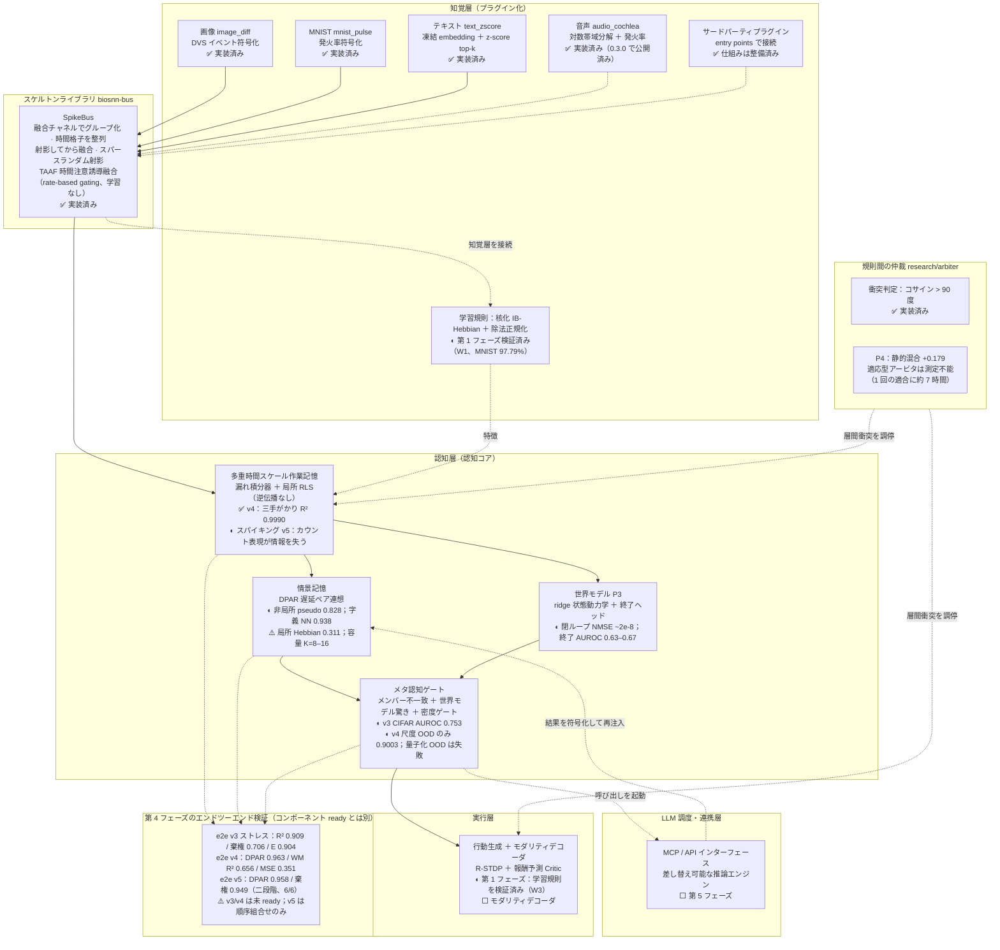

# BioSNN-Plug

**高い生物学的妥当性を志向した全モダリティ・スパイキングニューラルネットワーク認知プロトタイプ**

> **翻訳されている範囲について。** ドキュメントは中国語・英語・日本語で提供していますが、
> **コードは翻訳されていません**——docstring、コメント、エラーメッセージは中国語のみです。
> そのため非中国語話者がライブラリを使うと、中国語のテキストに触れることになります。
> また、この日本語版は機械支援による翻訳であり、母語話者によるレビューを受けていません。
> 不自然な箇所があれば issue でお知らせください。

[中文](README.md) · [English](README.en.md) · [プロジェクト計画書 v6.2](BioSNN-Plug_项目计划书_v6.2.md) · [v6.3（引用訂正版）](BioSNN-Plug_项目计划书_v6.3.md) · [計画書とリポジトリの乖離監査（中国語）](BioSNN-Plug_计划书差距审计.md) · [プラグイン開発ガイド](docs/plugin_guide.ja.md) · [アーキテクチャ決定記録](docs/adr/README.ja.md)

> **二つの版の関係**：**v6.2 が正式なプロジェクト計画書**です。**v6.3** は最初の引用考証による訂正を反映した版です（変更点は [`docs/references.ja.md`](docs/references.ja.md) の「計画書本文の訂正待ち項目」にあります）。引用は v6.2 を、訂正後の表現（Trace Propagation の位置づけ、TD-LTP の出典など）が必要なときは v6.3 を使ってください。

[](https://github.com/lzmd-arch/BioSNN-Plug/actions/workflows/ci.yml)
[](LICENSE)
[](https://www.python.org/downloads/)
[](https://colab.research.google.com/github/lzmd-arch/BioSNN-Plug/blob/main/examples/quickstart_register_plugin.ja.ipynb)

## 発表とアーカイブ

[](https://doi.org/10.5281/zenodo.23429379)

| 成果物 | 種別 / ライセンス | 識別子 | 状態 |
| :--- | :--- | :--- | :--- |
| **P2 論文**：W2 e-prop と同予算 BPTT の対照 | プレプリント / CC-BY-4.0 | [10.5281/zenodo.23429379](https://doi.org/10.5281/zenodo.23429379) | 公開済み（v1.1、2026-10-17） |
| **P4 論文**：仲裁はいつ測れるか（協同ベンチマーク＋プロトコル） | プレプリント / CC-BY-4.0 | [10.5281/zenodo.23613539](https://doi.org/10.5281/zenodo.23613539) | 公開済み（v1.0、2026-10-24） |
| **記録 A**：W2 の発見とプロトコルのスナップショット | レポート / Apache-2.0 | [10.5281/zenodo.23428426](https://doi.org/10.5281/zenodo.23428426) | 公開済み（v0.2、2026-10-17） |
| **記録 C**：P4 の設計ノート（仲裁の形式化、協同性基準の判定基準、三つの裁定） | レポート / Apache-2.0 | [10.5281/zenodo.23603639](https://doi.org/10.5281/zenodo.23603639) | 公開済み（v0.1、2026-10-24） |
| **記録 D**：アーキテクチャと設計判断の記録（計画書 v6.3、ADR 索引、四軸フレーム） | Other | [10.5281/zenodo.23603642](https://doi.org/10.5281/zenodo.23603642) | 公開済み（v0.1、2026-10-24） |

⚠️ アーカイブは**不変のスナップショット**であり、保存した時点の状態を記録したものです。現在の数値は本 README と[再現記録](docs/reproducibility.ja.md)を参照してください。

## これは何か

研究プロトタイプであり、一つの問いを検証する：**知性は純粋に局所的な学習則から育つことができ、外部推論を借りて自らの境界を拡張することを学べるか？**

三つの具体的な主張：

1. **代理勾配をスキップする**——シナプス更新はすべて局所信号によって駆動される（知覚層はカーネル化 IB-Hebbian、認知層は e-prop、実行層は R-STDP）；
2. **モダリティのプラグイン化**——テキスト／画像／音声を独立したプラグインとして共有の認知コアに接続し、モダリティを追加しても既存のアーキテクチャを変更しない；
3. **SNN が自ら LLM を呼び出す**——SNN が認知主体であり、「いつ行動するか、何を関連づけるか」を決める；LLM は交換可能な推論エンジンとして「何を生成するか」だけを担う。

## これは何ではないか

**プロダクションフレームワークではない。** SOTA を目指さず、可用性も約束せず、メンテナは 1 名で、issue に SLA を設けない。

**汎用の SNN ライブラリではない。** 性能は目標ではなく、価値は高リスクな路線が成立するかどうかの検証にある。

**インスピレーションではなく証拠である。** 結論は本リポジトリで再現できなければならない；検証できなかった引用には正直に `unverified` を付ける（[引用リスト](docs/references.ja.md) 参照）。

## 類似プロジェクトとの関係

一目でわかる対照表です。**各セルの根拠とライセンス境界（どの依存に入れられるか、どれは
一行も写せないか）は [`docs/related_projects.ja.md`](docs/related_projects.ja.md) にあります。**

| | 純粋な局所学習 | モダリティプラグイン | 自律トリガ | 継続学習 | オープンソース枠組み |
| :--- | :---: | :---: | :---: | :---: | :---: |
| **Javis** | ◐ すべて STDP ファミリ、逆伝播なし（12 種から選択）；注意：**自前の `iter-45` reward ベンチマークで両アームとも偶然水準を超えず**（README 原文「neither arm reaches above-chance accuracy」） | ✗ | ✗ | ✗ | ◐ Rust だが **PolyForm 非商用** |
| **EMBER** | ◐ STDP + 適格性痕跡 × ドーパミンゲーティング | ✗（テキストのみ） | ◐ 観察レベル、**N=1** | ✗ | ✗ 公開リポジトリなし |
| **MEMBRAIN** | ◐ Voja + PES | ✗ | ✗ | ◐ 主張と実装が一致しない | ✅ Nengo（MIT） |
| **eprop-PyTorch / ESPP** | ✅ e-prop；ESPP は別の並列な規則 | ✗ | ✗ | ✗ | ◐ コード断片であり枠組みではない |
| **BioSNN-Plug**（本プロジェクト） | ✅ 三本のラインすべて受入済み | ✅ プラグイン 4 本（画像 / MNIST / テキスト / 音声） | ○ 第 5 フェーズ | ◐ 第 3 フェーズ（タスク認識 CIL は通過；3× は未達） | ✅ `biosnn-bus` は PyPI に公開済み |

凡例：**✅ 実装済みかつ受入データあり** · **◐ 部分**（機構または証拠が不十分） ·
**○ ロードマップのみ（計画書にタスクはあるが未着手）** · **✗ なし**

⚠️ **最終行の 2 セルは ✅ ではありません**——「自律トリガ」は第 5 フェーズで**未着手**；
「継続学習」は第 3 フェーズで **◐** までです：タスク認識 CIL は通過（ADR-0018）しましたが、
「再学習 3×」は未達（ADR-0019）。記号を分けているのは、この表が「もう達成した」と読まれない
ようにするためです。

## 研究の位置づけ

「知能はなぜ創発するのか」を四つの軸に分ける：**基質**（規模・次元・シナプス数）、
**動力学**（学習を偏らせる大域状態変数——ホルモン・情動・固定化・本能）、**組織**
（遺伝的プレワイヤリング・脳領域分化・新旧交代・自己増殖）、**接地**（物理規則・実知覚・
モダリティの忠実度）。関係があるとすれば**乗法**である：いずれかの軸がゼロなら全体が頭打ちになる。

**本プロジェクトの賭け**：基質軸の競争から降りる——そこには参加者も計算資源も足りている。
資源は**動力学 × 組織が基質を代替できるか**に賭け、その問いを測れる計器を作る。答えが
肯定なら、規模は創発の原因ではなく、ある組織のあり方が許す到達点にすぎない。

測定の規律は宣言ではない：事前登録、自明解の排除、マシンチェックリスト、負の検証の記録は[再現記録](docs/reproducibility.ja.md)を参照。

## 現在の状態

| 部分 | 状態 | 最終更新 |
| :--- | :--- | :--- |
| `biosnn-bus` スケルトンライブラリ | **0.3.0（音声プラグインを含む。PyPI 公開済み）**——プラグインインターフェース、登録と検出、スパイクバス、**TAAF 時間注意融合**（rate-based gating：重みは各系統の発火率から計算、**逆伝播なし**）；`Used in:` [Axo](https://github.com/lzmd-arch/Axo)（出荷中のターミナル）：常駐プロセス `axo.busd` が `SpikeBus` を生成して継続的に `step()` を呼び（融合＋疎ランダム射影）、新しい記憶は独自の `ModalityPlugin` で符号化してバスへ入る。UI は stdlib が書く JSONL イベントのみを読み、本ライブラリを import しない | 2026-10-18 |
| モダリティプラグイン | **4 本**：`image_diff`（DVS イベント符号化）、`mnist_pulse`（発火率）、**`text_zscore`**（凍結ローカル embedding ＋ z-score top-k 集団符号化）、**`audio_cochlea`**（対数帯域分解＋発火率；0.3.0 で PyPI 公開済み） | 2026-10-18 |
| 研究コード：三つの検証ライン | **第 1 フェーズの実装完了**——W1 Hebbian 知覚 MNIST **97.79%**（既定の閉形式読み出し；SGD 読み出し 98.01%）✓；W2 e-prop 系列 sMNIST **0.7764**（30 エポック × 5 シード）→ **0.8889**（**公式收官**：**LIF** @ lr=1e-2 @ 250 エポック、収束；同条件の ALIF 0.8831 は対照；**同予算の BPTT 対照 0.9630、7.41 ポイント先行**——この差はそのまま書く：局所規則は依然として誤差逆伝播に劣る；**レシピ待遇の定量**：BPTT の最適化器の形式は小さい学習率で **+8.53 pp**、最終的に選んだ学習率では **+0.88 pp**（タイ帯の内側）——動作点では両腕のレシピは比較可能）；lr 交互扫描完了、**LIF は四つの lr 全域で先行** ✓；W3 R-STDP CartPole 中央値 **237.8 歩**（基準 ≥ 200）✓。数値と再現記録は[再現記録](docs/reproducibility.ja.md) 参照 | 2026-10-18 |
| **ネットワーク規模** | **スパイキングニューロン 256 個**（W2）。W1 には**レート型**ユニット 3,072 個が別にある（スパイキングニューロンには数えない）。計画書 §2.2 の認知コアは約 5 万を目標——**約 195 倍の隔たり**。詳細は [research/README](research/README.ja.md) | 2026-10-18 |
| アービタ | **P4 最終結論**（`research/arbiter/`）：静的 50/50 混合はどちらか単独より優れ、相乗量 **+0.179**；**適応型アービタは本ベンチマークでは測定不能**——事前登録プロトコルにより処決、完全プローブは 1 回の適合に約 7 時間。→ [論文二](paper/p4/)（Zenodo `10.5281/zenodo.23613539`）。歴史的な口径は同ディレクトリの README に残す | 2026-10-24 |
| 実行層のスパイク化（第 3 フェーズ） | **入口、線形 TD Critic、TD-LTP 集団 Critic はいずれも就位したが、200 を超えたものは一つもない。** ⚠️ **2026-10-18 以前の数値はすべて無効**：学習エピソードに環境シードが無く、同一シードでも軌道が異なっていた。修正後の **10 シード比較**：線形 TD 中央値 50.4、集団の既定 55.0、動作点 37.1——**区間はすべて重なり、いずれも 0/10**。三つの主腕は区別できない。レート版の中央値 237.8 が受入を通った唯一の実装。詳細は [research/rstdp_spiking](research/rstdp_spiking/README.ja.md) | 2026-10-18 |
| 第 3 フェーズ：継続学習／再学習 | **部分受入**——CL ゲートは [ADR-0018](docs/adr/ADR-0018-task-aware-cl-gate.ja.md) でタスク認識 CIL に変えた後で通過（oracle per-task **0.8195 / AF 0.0**、構成的）；純 CIL **0.0876 / AF 0.290**、タスク推論の最良 **0.5855 / 0.1285** はいずれも未達。**「再学習 3×」は v1–v3 で未達**（正式ラウンドのペア中央値 **0.957**、校正で約 **1.06**）。[ADR-0019](docs/adr/ADR-0019-stage-four-entry-decoupled-from-relearn.ja.md) により未解決の開放項目として記録。 | 2026-10-27 |
| 第 4 フェーズ：認知拡張 | **複数コンポーネントは ready、エンドツーエンドは未受入**——WM v4 **0.9990**（局所 RLS）；情景 DPAR 字義 NN **0.938**、pseudo **0.828**、局所 Hebbian **0.311**；メタ認知 v3 CIFAR AUROC **0.753**、v4 は尺度 OOD のみ **0.9003**（量子化 OOD は 0.4876 で失敗）；世界モデル P3 の終了 **0.63–0.67**；e2e v2 は 5/5（易しすぎる）、e2e v3 は 4/5（棄権 **0.7056**）、e2e v4 は 4/6（DPAR **0.963**、MSE **0.351** 未達）、e2e v5 は 6/6（二段階 WM→DPAR、DPAR **0.958**、OOD 棄権 **0.949**）。詳細は [第 4 フェーズ状態](docs/stage4_status.ja.md) | 2026-10-27 |
| 跨モダリティ検索 | **検索実験を十ラウンド**：当初の基準（絶対 R@1 50%）は二つのデータセットのいずれでも「局所学習が成立する」ことを判別できず、**回復率**へ言い換えた（合成 75.2%、Flickr8k **78.7%**、全グリッド）；Flickr8k の**フロントエンド**には別の受入口径がある——キャプション内容語の線形プローブ AUC 中央値 **0.790**（テキスト側の自己検査 1.000） | 2026-10-17 |
| 第 5 フェーズ：LLM 連携 | **未着手**、[プロジェクト計画書 §七](BioSNN-Plug_项目计划书_v6.2.md) を参照 | — |

**第二段階の成功基準の実態**：

| 基準 | 状態 |
| :--- | :--- |
| プラグインを独立に差し替えられる | ✅ 4 本のプラグイン ＋ entry points、スケルトンライブラリは PyPI に公開済み |
| TAAF の微調整サンプル数 < ゼロからの学習の 1/10 | ⚠️ **基準は [ADR-0012](docs/adr/ADR-0012-taaf-locality-and-bus-output-contract.ja.md) により消滅したのであって、達成ではない**——融合重みはレッドラインに従い一切学習しないため、この基準には**指す対象がありません**（微調整が無い以上、「微調整サンプル数」も無い）。計画書の改訂記録 27 参照 |
| 跨モダリティ検索 R@1 50%+ | ⚠️ **当初の基準（絶対 50%）は未達で、判別力なしと判定済み**（合成セットは記憶化で満たせる；Flickr8k 凍結フロントエンドの上界は 0.076）。**「回復率」へ言い直して通過**：局所規則は線形上界の **75.2%（合成セット）/ 78.7%（Flickr8k、完全グリッド）** を取り戻す——[research/retrieval](research/retrieval/README.ja.md) を参照 |
| 仲裁器が双規則の衝突イベントを 50% 以上減らす | ⚠️ 元の判定基準は合成データ上で**自明に成立**し、相乗性ベンチマークに置き換えられた。P4 最終：静的混合 **+0.179**、適応型は**測定不能**（1 回の適合に約 7 時間） |

明確にしておくべき境界が 3 つある：

- **TAAF は実装済みだが、既定の融合戦略は依然として連結**：`TemporalAttentionFusion` は**明示的に選ぶ**融合戦略（`SpikeBus(strategy=...)`）で、既定は単純連結のままです。注意：その注意重みは**各経路の発火率から計算し、学習しません**（rate-based gating）——このレッドラインは **AST による構造的アサーション**で固定しています。[ADR-0012](docs/adr/ADR-0012-taaf-locality-and-bus-output-contract.ja.md) 参照。
- **知覚層は凍結した事前学習済みフロントエンドを使ってよい**（境界宣言、[計画書 §2.3](BioSNN-Plug_项目计划书_v6.3.md) 参照）：「純粋な局所学習」という主張の範囲は**シナプス学習規則**であって、**入力エンコーダではありません**。判定は「パラメータが勾配に入るか」であって「モデルが大きいか」ではない——凍結した 2GB の事前学習済み embedding は、固定ランダム射影とこの点で等価です。逆に、100 行のローカルエンコーダが逆伝播で自身のパラメータを学習するなら、この境界に**違反**します。テキストプラグインの `nomic-embed-text`（Ollama、768 次元）は凍結です。
- （スケルトンライブラリがなぜ独立したパッケージなのか、なぜこれらを意図的に含めないのかは [ADR-0001](docs/adr/ADR-0001-skeleton-as-separate-library.ja.md) 参照。）
- スケルトンライブラリは**PyPI にリリース済み**です：`pip install biosnn-bus`（PyPI は `0.3.0`、`audio_cochlea` 音声プラグインを含む）。リリースは PyPI の trusted publishing（OIDC、トークンを保存しません）で行い、手順は [release.yml](.github/workflows/release.yml) にあります。

## 探索項目（現行スケジュール外）

以下三件はすでに立ち上げているが、**現フェーズのスケジュールを一切消費しない**。各項目に
発動条件を明記し、条件が満たされるまで着手しない。ここに書くのは、「やっていない」と
「やる予定がない」を玄関で区別するためである。

| 項目 | 所属 | 発動条件 |
| :--- | :--- | :--- |
| **世界モデルコンポーネント**（[ADR-0015](docs/adr/ADR-0015-world-model-as-phase-four-component.ja.md)） | 第 4 フェーズの正式コンポーネント（Predictive E-prop を継承） | **着手済み**（第 3 フェーズは ADR-0019 で部分受入、ADR-0015 は成立）：P3 の閉ループは安定（NMSE ~2e-8）、終了ヘッド AUROC 0.63–0.67 で未達 |
| **覚醒チャネル**（[ADR-0016](docs/adr/ADR-0016-arousal-channel-and-consolidation-experiment.ja.md)） | 動力学軸のコンポーネント化 | コンポーネント化の ADR が承認されること |
| **PINN の物理事前分布**（[v7.0 候補](docs/roadmap_v7_candidates.ja.md)） | ロードマップ v7.0 候補（探索ノート） | 第 3 フェーズの受入＋ CL プローブの実装；再確認は 2027 年夏 |

## アーキテクチャ

データは下から上へ流れる。✅ は現在のリポジトリで既に動き、事前登録した基準で ready／通過したもの；◐ は実装済みだが限定した口径でのみ ready、または境界が残るもの；⬜ は未着手のもの——同じ図に描いているのは、この図が同時にロードマップでもあるためだ。第 4 フェーズのエンドツーエンド基準は別ノードに示す。



層間の衝突は **ES メタ学習アービタ**が調停します。P4 の最終結論は：**静的 50/50 混合は
どちらか単独より優れ、相乗量 +0.179**；一方、**適応型アービタは本ベンチマークでは測定不能**
です——事前登録プロトコルにより処決され、完全プローブは 1 回の適合に約 7 時間かかります。
旧口径（「衝突イベント 50% 減」は合成データ上で自明に成立）は歴史的記録として
[`research/arbiter/README`](research/arbiter/README.ja.md) に残しています。

注意：**図の ✅ は「実装済み」であって、「路線図が置く場所に接続済み」という意味では
ありません**：TAAF は実装されていますが**明示的に選ぶ**戦略で（既定は連結のまま）、
テキストプラグインは実装されていますが**凍結した事前学習済みエンコーダ**を前に置いて
います（境界宣言は[計画書 §2.3](BioSNN-Plug_项目计划书_v6.3.md)——「純粋な局所学習」は
シナプス規則の話で、入力エンコーダの話ではない）。各層の学習則の完全な説明は
[プロジェクト計画書](BioSNN-Plug_项目计划书_v6.2.md) §2、§3 参照。

## クイックスタート

numpy だけに依存し、GPU は不要です：

```bash
pip install biosnn-bus
```

（`main` 上の**未リリース**の変更を入れる場合のみ Git 経由で：`pip install "biosnn-bus @ git+https://github.com/lzmd-arch/BioSNN-Plug.git#subdirectory=packages/biosnn-bus"`）

モダリティプラグインは 3 つのメソッドと 2 つのプロパティでできている：

```python
import numpy as np

from biosnn_bus import ModalityPlugin, PassThroughMembrane, SpikeBus, SpikeTrain


class LevelEncoder(ModalityPlugin):
    """一次元信号をレベルに応じて集団スパイクに符号化する。"""

    def __init__(self, spike_dim: int = 16) -> None:
        self._spike_dim = spike_dim
        self.levels = np.linspace(0.0, 1.0, spike_dim)

    @property
    def modality_name(self) -> str:
        return "level"

    @property
    def spike_dim(self) -> int:
        return self._spike_dim

    def encode(self, raw_input) -> SpikeTrain:
        signal = np.asarray(raw_input, dtype=np.float64).reshape(-1)
        radius = 0.5 / (self._spike_dim - 1)
        return SpikeTrain(data=np.abs(signal[:, None] - self.levels) <= radius)

    def get_membrane(self):
        return PassThroughMembrane()

    def decode(self, spike_output: SpikeTrain):
        return spike_output.data.astype(float) @ self.levels


bus = SpikeBus(bus_dim=64, seed=0)
bus.register(LevelEncoder())
output = bus.step({"level": np.linspace(0, 1, 12)})
print(output)
```

[Colab デモ](https://colab.research.google.com/github/lzmd-arch/BioSNN-Plug/blob/main/examples/quickstart_register_plugin.ja.ipynb)（5 分、GPU 不要）は、プラグインから認知コアの入口までの完全なスパイクラスタプロットを描く。

サードパーティのパッケージにプラグインを提供させたい？**本リポジトリのコードを 1 行も変更する必要はない**——[プラグイン開発ガイド](docs/plugin_guide.ja.md#サードパーティパッケージからプラグインを提供する) 参照。

## リポジトリ構成

```text
packages/biosnn-bus/   スケルトンライブラリ：独立した配布パッケージ、semver に従い、研究コードに一切依存しない
research/              研究コード：第 1 フェーズから埋める、12 か月の破壊的変更免責期間
examples/              実行できるサンプル；スクリプトが唯一の真実の源で、notebook はそこから生成する
docs/                  プラグインガイド、ADR、再現チェックリスト、引用リスト
scripts/               CI と pre-commit が使うチェックスクリプト
```

## メンテナンス方針

メンテナは 1 名。完全な再現手順を伴う報告を優先して扱う。

- `biosnn-bus` は semver に従い、現在は `0.x`——慣例により 0.x ではマイナーバージョンで破壊的変更を許容し、最初に外部から依存されるバージョンで `1.0.0` に上げる；
- `research/` 配下のコードは最初の 12 か月（2027-09 まで）は互換性を約束しない；
- サードパーティのモダリティプラグインは独立したパッケージにすればよく、本リポジトリに PR を出す必要はない（[ADR-0003](docs/adr/ADR-0003-entry-point-plugin-discovery.ja.md)）。

## 謝辞

本プロジェクトの開発では **DeepSeek** の大規模モデルサービスを利用した。文献と API の調査、
コードの草案、デバッグ、ドキュメントの推敲の各段階に参加している。

境界は本リポジトリが常に用いる書き方で明示する：**再現できない結論は一つも生んでいない**。
`research/` と `sweep_results/` のすべての数値は、再実行できるスクリプトと実行ごとの記録に
由来し、テストと CI が守っている。主張と誤りはメンテナの責任である。これは論文の AI 利用
表明と同じ基準であり、[paper/README.md](paper/README.md) の「Use of AI assistance」節にある。

## ライセンスと引用

コードは [Apache-2.0](LICENSE)、ドキュメントとプロジェクト計画書は [CC-BY 4.0](https://creativecommons.org/licenses/by/4.0/)。データセットは各データソースのライセンスに従い、本リポジトリはデータミラーを提供しない；ダウンロードと前処理スクリプトは [scripts/download_data.py](scripts/download_data.py)。

研究ラインが依存する **SpikingJelly は啓智オープンソースライセンス 1.0（OIOSL）を使い、Apache-2.0 ではない**。研究用途では発動しないが、**商用利用・再配布には AITISA への開示申告が必要**。その取舍と Python 下限への影響は [ADR-0008](docs/adr/ADR-0008-spikingjelly-license-and-python-floor.ja.md) を参照。

引用には [CITATION.cff](CITATION.cff) を使う。
