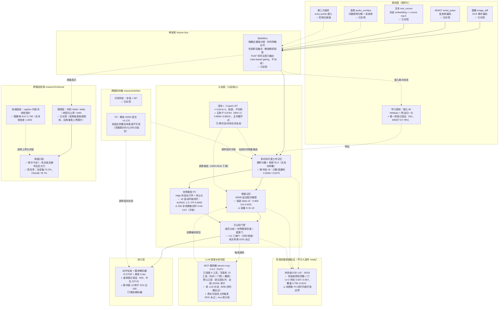

# BioSNN-Plug

**面向高生物合理性的全模态脉冲神经网络认知原型**

> Spiking neural networks (SNN) · biologically plausible local learning rules · no surrogate gradients · e-prop / Hebbian / R-STDP · neuromorphic computing · modality plugins · LLM orchestration

[English](README.en.md) · [项目计划书 v6.2](BioSNN-Plug_项目计划书_v6.2.md) · [v6.3（引用修订版）](BioSNN-Plug_项目计划书_v6.3.md) · [计划书差距审计](BioSNN-Plug_计划书差距审计.md) · [插件开发指南](docs/plugin_guide.md) · [架构决策记录](docs/adr/README.md)

> **两个版本的关系**：**v6.2 是正式计划书**；**v6.3** 把第一批引用考证的更正并了进去（改了哪些见 [`docs/references.md`](docs/references.md) 的「计划书正文待更正项」）。引用计划书时以 v6.2 为准；需要用到更正后的表述（例如 Trace Propagation 的定位、TD-LTP 的出处）时用 v6.3。

[](https://github.com/lzmd-arch/BioSNN-Plug/actions/workflows/ci.yml)
[](LICENSE)
[](https://www.python.org/downloads/)
[](https://colab.research.google.com/github/lzmd-arch/BioSNN-Plug/blob/main/examples/quickstart_register_plugin.ipynb)

## 发表与存档

[](https://doi.org/10.5281/zenodo.23819564)

| 产出 | 类型 / 许可 | 标识 | 状态 |
| :--- | :--- | :--- | :--- |
| **Paper A**：局部学习规则的诚实测量（含脉冲执行层十六轮诊断、事件驱动 e-prop、失败库） | 预印本 / CC-BY-4.0 | [10.5281/zenodo.23819564](https://doi.org/10.5281/zenodo.23819564) | 已发表（v1.1，2026-10-31；取代原 P2 v1.1 `zenodo.23429379`） |
| **Paper B**：无尺度涌现——动力学与组织对基质赌注的检验（仲裁 + 认知层 + 编排 + 读写边界） | 预印本 / CC-BY-4.0 | [10.5281/zenodo.23820978](https://doi.org/10.5281/zenodo.23820978) | 已发表（v1.2，2026-10-31；取代原 P4 v1.0 `zenodo.23613539`；v1.2 只修排版） |
| **记录 A**：W2 发现与协议快照 | 报告 / Apache-2.0 | [10.5281/zenodo.23428426](https://doi.org/10.5281/zenodo.23428426) | 已发布（v0.2，2026-10-17） |
| **记录 C**：P4 设计笔记（仲裁形式化、协同性基准判据、三条裁决） | 报告 / Apache-2.0 | [10.5281/zenodo.23603639](https://doi.org/10.5281/zenodo.23603639) | 已发布（v0.1，2026-10-24） |
| **记录 D**：架构与设计决策存证（计划书 v6.3、ADR 索引、四轴框架） | Other | [10.5281/zenodo.23603642](https://doi.org/10.5281/zenodo.23603642) | 已发布（v0.1，2026-10-24） |
| **阶段四技术报告**：组件记分卡与 v1–v9 端到端边界 | 报告 / CC-BY-4.0 | [10.5281/zenodo.23696829](https://doi.org/10.5281/zenodo.23696829) | 已发布（v1.0，2026-10-28） |

⚠️ 存档是**不可变快照**，记的是存款当时的状态；当前数字以本 README 与[复现记录](docs/reproducibility.md)为准。

## 这是什么

研究原型，验证一个问题：**智能能否从纯局部学习规则中生长出来，并学会借助外部推理扩展自身边界？**

三条具体主张：

1. **跳过代理梯度**——突触更新全部由局部信号驱动（感知层核化 IB-Hebbian、认知层 e-prop、执行层 R-STDP）；
2. **模态插件化**——文本/图像/音频作为独立插件接入共享认知核心，新增模态不改已有架构；
3. **SNN 自主调用 LLM**——SNN 是认知主体，决定"何时行动、关联什么"；LLM 作为可替换的推理引擎只负责"生成什么"。

## 这不是什么

**不是生产框架。** 不追求 SOTA，不承诺可用性，单人维护，issue 不设 SLA。

**不是通用 SNN 库。** 性能不是目标，价值在于验证一条高风险路线是否成立。

**是证据，不是灵感。** 结论要能在本仓库复现；核验不到的引用如实标 `unverified`（见[引用清单](docs/references.md)）。

## 和同类项目的关系

同类路线一眼对照。**每一格的依据、以及许可边界（哪个能进依赖、哪个一个字都不能抄），
在 [`docs/related_projects.md`](docs/related_projects.md)。**

| | 纯局部学习 | 多模态插件 | 自主触发 | 持续学习 | 开源框架 |
| :--- | :---: | :---: | :---: | :---: | :---: |
| **Javis** | ◐ 全是 STDP 家族、无反向传播（12 条可选）；⚠️ **但作者自建的 `iter-45` reward 基准两臂都没过随机水平**（README 逐字「neither arm reaches above-chance accuracy」） | ✗ | ✗ | ✗ | ◐ Rust，但**PolyForm 非商业** |
| **EMBER** | ◐ STDP + 资格痕迹 × 多巴胺门控 | ✗（仅文本） | ◐ 观察级，**N=1** | ✗ | ✗ 无公开仓库 |
| **MEMBRAIN** | ◐ Voja + PES | ✗ | ✗ | ◐ 自报与实现不符 | ✅ Nengo（MIT） |
| **eprop-PyTorch / ESPP** | ✅ e-prop；ESPP 是另一条并列规则 | ✗ | ✗ | ✗ | ◐ 代码片段，非框架 |
| **BioSNN-Plug**（本项目） | ✅ 三条线全部验收 | ✅ 四路插件（图像/MNIST/文本/音频） | ◐ 第五阶段 M0–M3p（真 LLM 与脉冲触发已接；真实流 ROC 未过） | ◐ 第三阶段（任务感知 CIL 过；3× 未达） | ✅ `biosnn-bus` 与 `biosnn-mcp` 都已上 PyPI |

图例：**✅ 已实现并有验收数据** · **◐ 部分**（机制或证据不全） · **○ 只在路线图里（计划书有任务，未开始）** · **✗ 无**

⚠️ **本表最后一行有两格不是 ✅**——「自主触发」在第五阶段已接到**真实 LLM 与脉冲触发**（M3b 真 qwen3-4b 四判据全过、M3k 在合成流上 5/5），但 **M3l 在真实对话流上的 ROC 未过**（AUC 0.732 vs 规则门 0.7475）；「持续学习」在
第三阶段只到 **◐**：任务感知 CIL 过（ADR-0018），但「重学快 3×」未达（ADR-0019）。把符号
分开写，就是为了不让这张表读起来像我们已经做到了。

## 研究定位

把"智能为什么涌现"拆成四轴：**基质**（规模、维度、突触数）、**动力学**（全局状态变量偏置学习——
激素、情绪、巩固、本能）、**组织**（基因预编码、脑区分化、新旧更替、自增殖）、**接地**（物理规则、
真实感知、模态拟真）。四者若真有关系，是**乘法**：任何一轴为零，整体就封顶。

**我们的押注**：退出基质轴的竞争——那里不缺参与者，也不缺算力；把资源押在
**动力学 × 组织能否替代基质**上，做一台能测这个问题的仪器。若答案是肯定的，规模就不是
涌现的原因，而是组织方式允许达到的尺度。

测量纪律不是宣言：预注册、平凡解排查、机器检查单与负向验证，都记录在[复现记录](docs/reproducibility.md)里。

## 当前状态

| 部分 | 状态 | 最近更新 |
| :--- | :--- | :--- |
| `biosnn-bus` 骨架库 | **0.3.0（含音频插件，已发布到 PyPI）**——插件接口、注册与发现、脉冲总线、**TAAF 时间注意力融合**（rate-based gating，权重由各路发放率现算，**无反向传播**）；`Used in:` [Axo](https://github.com/lzmd-arch/Axo)（生产终端）：其独立进程 `axo.busd` 常驻实例化 `SpikeBus` 并持续 `step()`（融合 + 稀疏随机投影），新记忆经自定义 `ModalityPlugin` 编码后进总线；UI 只读 stdlib 写的 JSONL 事件，不 import 本库 | 2026-10-18 |
| 模态插件 | **四路**：`image_diff`（DVS 事件编码）、`mnist_pulse`（发放率）、**`text_zscore`**（冻结本地 embedding + z-score top-k 群体编码）、**`audio_cochlea`**（对数频带分解 + 发放率；随 0.3.0 发布到 PyPI） | 2026-10-18 |
| 研究代码：三条验证线 | **第一阶段实现完成**——W1 Hebbian 感知 MNIST **97.79%**（默认闭式解读出；SGD 读出 98.01%）✓；W2 e-prop 序列 sMNIST **0.7764**（30 epoch × 5 种子）→ **0.8889**（**官方收官**：**LIF** @ lr=1e-2 @ 250 epoch，已收敛；同档 ALIF 0.8831 为对照；**同预算 BPTT 对照 0.9630，领先 7.41 个百分点**，这条差距照实写：局部规则仍落后于反向传播；**配方待遇量化**：BPTT 的优化器形式在小学习率上值 **+8.53 pp**（1e-3），在最终选定的学习率上只剩 **+0.88 pp**（落在并列带内）——操作点上两臂的配方是可比的）；lr 交互扫描完成，**LIF 在四档 lr 上全网格领先** ✓；W3 R-STDP CartPole 中位数 **237.8 步**（阈值 ≥ 200）✓。数字与复现记录见[复现记录](docs/reproducibility.md) | 2026-10-18 |
| **网络规模** | **256 个脉冲神经元**（W2）；W1 另有 3,072 个**速率型**单元（不算脉冲神经元）。计划书 §2.2 的认知核心目标是约 5 万——**差约 195 倍**，详见 [research/README](research/README.md) | 2026-10-18 |
| 仲裁器 | **P4 终版结论**（`research/arbiter/`）：静态 50/50 混合优于任一单方，协同量 **+0.179**；**自适应仲裁在本基准不可测**——被预注册协议处决，完整探针约七小时/次拟合。见[论文二](paper/p4/)（Zenodo `10.5281/zenodo.23613539`）；历史口径留在该目录 README | 2026-10-24 |
| 执行层脉冲化（第三阶段） | **入口、线性 TD Critic、TD-LTP 群体 Critic 均已就位，但一个都没过 200。**⚠️ **2026-10-18 之前的数字全部作废**：训练回合漏了环境种子，同种子两次轨迹不同；修复后 **10 种子对照**：线性 TD 中位数 50.4、群体默认 55.0、工作点 37.1——**区间全部重叠、均 0/10**，三个主臂分不开。速率版中位数 237.8 仍是唯一通过验收的实现。见 [research/rstdp_spiking](research/rstdp_spiking/README.md)；**2026-10-29 count-aligned 资格 0/10、中位 9.5，仍未 ready**，见 [`rstdp_spiking_count_aligned`](sweep_results/rstdp_spiking_count_aligned/README.md)；**重学 3× v4（保留探索状态）速度比 3.5× 但有效性门未过**，见 [`relearn_3x_v4`](sweep_results/relearn_3x_v4/README.md)；**2026-10-29 口径复核：26 个历史臂末次中位只有 9–18，`best_steps` 只是峰值**；D3–D8 把原因定位到**末期读出无状态信息**（D6 温度修好熵坍缩但末次仍 9.5；D8 5/5 `no_state_information`）；**D10–D15 六轮诊断收口：差方向存在（4/5 种子，相对幅度 0.5–7.3%）但比任何读出能分辨的尺度小一个数量级——计数/低通率/膜电位/潜伏期四种读出都不够，唯一有效杠杆是平均 ≥8 个窗口（`snr ∝ K^0.6`）**，；**D9 contrastive（γ 0/0.1/0.5）：γ=0.1 把 Δ 极差从中位 0.20 抬到 0.60（判据 2 过），但末次中位仍 9.5、极角 slope 仍 0/10；γ=0.5 把 `best` 均值从 39.4 砸到 13.1 → 幅度不是瓶颈，符号的状态依赖才是**，；**D16 把差方向对状态均值正交化也不能让符号跨零（0/5）；⚠️ D17 上游复核：脉冲编码器在极角上的相对灵敏度只有 2.9%（cos 0.9988），其余三轴 1.1–1.4——D4/D8/D9 的「slope=0」是在输入侧几乎不变的维度上量的，不能读成学习规则无能**，；**D18 按轴归一化编码（σ′=0.35）后：末期 Δ 极差中位 0.2→6.2（30 倍），但 slope 仍 0/10 为正、末次中位仍 9.85（seed 4 = 269.1）→ 读出看得见状态了，策略还没有**，见 [阶段三读出诊断汇总](sweep_results/stage3_readout_audit.md)、[D9](sweep_results/rstdp_spiking_contrastive/README.md)、[D17](sweep_results/rstdp_spiking_encoder/README.md) 与 [D18](sweep_results/rstdp_spiking_normalised/README.md) | 2026-10-29 |
| 阶段三：持续学习 / 重学 | **部分验收**——CL 门按 [ADR-0018](docs/adr/ADR-0018-task-aware-cl-gate.md) 改为任务感知 CIL 后过（oracle per-task **0.8195 / AF 0.0**，构造性）；纯 CIL **0.0876 / AF 0.290**、任务推断最好 **0.5855 / 0.1285** 均未过。**「重学快 3×」v1–v3 均未达**（正式轮配对中位 **0.957**、校准约 **1.06**），按 [ADR-0019](docs/adr/ADR-0019-stage-four-entry-decoupled-from-relearn.md) 记为开放项。 | 2026-10-27 |
| 阶段四：认知增强 | **组件 ready；状态级 E2E 18/18（v18）；纯想象 P3 开放**——WM v4 **0.9990**（局部 RLS）；情景 DPAR 字面 NN **0.938**、pseudo **0.828**、局部 Hebbian **0.311**；元认知 v3 CIFAR AUROC **0.753**、v4 仅尺度 OOD **0.9003**（量化 OOD 失效 0.4876）；世界模型 P3 终止 **0.63–0.67**；e2e v2 5/5（太易），e2e v3 4/5（弃权 **0.7056**），e2e v4 4/6（DPAR **0.963**、MSE **0.351** 未过），e2e v5 6/6（两段式 WM→DPAR，DPAR **0.958**、OOD 弃权 **0.949**），e2e v6 两臂均未 ready（dual WM R² **0.994** 但弃权 **0.622**），e2e v7 5/6（bank W 置信度：WM **0.994**、弃权 **0.786**），e2e v8 6/6（共享状态 + bank W 尺度门：弃权 **0.937**、AUROC **0.956**）；v9 稳健性主档过但稳健 false（s=2 弃权 **0.720**、K=8 WM R² **0.89975**）；v10 用收缩协方差门把 s=2 提到 **0.828**（覆盖 0.790、AUROC 0.894）；v11 三臂修好 K=8 的 WM（snapshot R² 0.994、longtau 0.901），但 shrunk 覆盖率仍 <0.78；v12 换 diag 门后两臂 ready（覆盖 0.782/0.805）；v14 状态级全矩阵 14/18；v16 换输入尺度门后 18/18，但那是输入级门、不是状态级元认知；v17 把元认知 v8 的状态级 kNN[errors,state_norm] 接到 18 格，只到 **12/18**（s=2 六格弃权 0.620–0.736 全失败），比 v14 少两格；v18 改用状态级预测范数 z 门后 **18/18**（s2 弃权 0.837–0.907、覆盖 0.795–0.814）。本轮新增：**WM v9 脉冲迹 0.9269/0.9276**（臂差 0.130，非平凡）；**情景 v5 局部 delta 0.805（K4 0.922）**；**元认知 v8 重建一致性门：量化弃权 0.898、AUROC 0.925、尺度 0.851**；v11 三维门四族 OOD 全过：time_shift 0.998、time_reverse 0.990、dim_dropout 0.858、correlated 0.987；**P3 v5 开环固定动作终止 AUROC 0.999996、FP 0.000504、命中 0.998**，滚动时域闭环 v6 AUROC 1.0、FP 0.000912、命中 1.0；500 步纯想象闭环仍 0.63–0.67、`p3_closed_loop_imagination_ready=false`。规模：8 GB 上限约 **1.35k** 循环神经元，500k 外推 **1.38 TB**；事件驱动 e-prop 已与 dense 同 mask 逐位一致；能效仅 45nm 代理 **51–256×**（非硬件）；神经发生最小探针负结果（线性 **0.432/0.310**；NCM 变体 **0.766/0.277**；v3 回放/护栏 `replay` **0.634**（旧任务 14/15 格 ≤2pp）、`margin` **0.697**（旧任务最大掉 34pp），0.90 四臂全不过）；事件优先级 v1 选中 0.339 但精度掉 **15.35pp**；**v2 按每步损失：选中 0.413、配对下降 **23.58pp**（10/10 种子变差）→ 两者都不 ready**；事件驱动**前向** 500k 5.02 s（不测训练）；跨模态迁移报告 CKA 0.418、图像探测 0.736、文本→图像 0.902（合成集，非验收）。完整边界见 [阶段四状态](docs/stage4_status.md)；**2026-10-29：Predictive E-prop 重建全过、自由运行仅 1/3 种子（ready=false）；事件驱动 10k 完整 1 epoch 60k 样本 40 min、acc 0.697** | 2026-10-29 |
| 跨模态检索 | **十轮检索实验**：原标准（绝对 R@1 50%）在两种数据上都无法区分「局部学习成立」，已重述为**恢复率**（合成集 75.2%、Flickr8k **78.7%**，完整网格）；Flickr8k 的**前端**另有验收口径——caption 内容词线性探针 AUC 中位数 **0.790**（文本侧自查 1.000） | 2026-10-17 |
| 第五阶段：LLM 协同 | **MCP 0.3（只读版 9 工具：4 只读 + 5 提议 `propose.*`；写版本 13 工具：提议进队列、门控落库、可撤销——两版默认都是只读档位，写版本要显式启动，全程 JSONL 审计）→ M1 mock LLM/trace → M2 规则触发（30 场景 0.733）→ M3b 真 qwen3-4b 四判据全过（完成率 0.975 vs 基线 0.350）→ M3e/M3f 真实嵌入闭环（6/8 合并、6 对误合并，间隔规则无效）→ M3h ES 调度 10/10 严格优于规则门 → M3i–M3k 脉冲触发（合成流 5/5 种子 4/4、误触发 0）**；**M3l 真实对话流 ROC：AUC 0.732 vs 规则门 0.7475、工作点 0/5；M3m 留一重标定把命中救到 3–5/5 但留出判据只过 1/5 折、池化 AUC 0.7472；M3n 换分数（`Rmean` 0.80 / `Rcentroid` 0.83）同批过线，M3o 换一批语料后判据复现、「换分数更好」却没复现（`R5` 自己就有 0.84），M3p 扩到 20 段：`Rmean` 均值 0.809、难批 0.752，但逐段只 12/20 比 `R5` 好 → 符号判据不过 → 仍不 ready**。见 [ADR-0020](docs/adr/ADR-0020-phase-five-m0-readonly-mcp.md)、[M3l 结果](sweep_results/phase5_m3l/README.md)、[M3m 结果](sweep_results/phase5_m3m/README.md)、[M3n](sweep_results/phase5_m3n/README.md)、[M3o](sweep_results/phase5_m3o/README.md)、[M3p](sweep_results/phase5_m3p/README.md) | 2026-10-29 |

**第二阶段的四条成功标准，实况**：

| 标准 | 状态 |
| :--- | :--- |
| 插件可独立替换 | ✅ 四路插件 + entry points，骨架库已上 PyPI |
| TAAF 微调样本量 < 从头训练 1/10 | ⚠️ **标准随 [ADR-0012](docs/adr/ADR-0012-taaf-locality-and-bus-output-contract.md) 消解，非达成**——融合权重按红线根本不训练，这条标准**失去了所指**（没有微调，就没有「微调样本量」）。见计划书修订说明 ㉗ |
| 跨模态检索 R@1 50%+ | ⚠️ **原标准（绝对 50%）未达成且被判无区分力**（合成集可被记忆化满足；Flickr8k 冻结前端上界 0.076）。**已重述为「恢复率」并通过**：局部规则拿回线性上界的 **75.2%（合成集）/ 78.7%（Flickr8k，完整网格）**——见 [research/retrieval](research/retrieval/README.md) |
| 仲裁器使双规则冲突事件减少 50%+ | ⚠️ 原判据在合成数据上**平凡成立**，已被协同性基准取代；P4 终版：静态混合 **+0.179**，自适应仲裁**不可测**（完整探针约七小时/次拟合） |

两处需要说清楚的边界：

- **TAAF 已实现，但默认策略仍是拼接**：`TemporalAttentionFusion` 是**显式选用**的融合策略（`SpikeBus(strategy=...)`），默认仍是平凡拼接。⚠️ 它的注意力权重**由各路发放率现算、不训练**（rate-based gating）——这条红线用 **AST 结构断言**钉死，见 [ADR-0012](docs/adr/ADR-0012-taaf-locality-and-bus-output-contract.md)。
- **感知层允许冻结预训练前端**（边界声明，见[计划书 §2.3](BioSNN-Plug_项目计划书_v6.3.md)）：「纯局部学习」的主张范围是**突触学习规则**，不是**输入编码器**。判据是「参数进不进梯度」，不是「模型大不大」——冻结的 2GB 预训练 embedding 与固定随机投影等价；反过来，100 行的本地编码器若用反向传播训自己参数，就**违反**这条边界。文本插件用的 `nomic-embed-text`（Ollama，768 维）就是冻结的。
- （骨架库为何独立成包、为何刻意不包含这些东西，见 [ADR-0001](docs/adr/ADR-0001-skeleton-as-separate-library.md)。）
- **两个包都已发布到 PyPI**：骨架库 `pip install biosnn-bus`（**0.4.0**：`ProjectedFusionStrategy` 能力协议、公开 `EmbeddingBackend` 注入点、统一 `SpikeBus.step()` 的 dtype 契约）；阶段五 MCP 服务器 `pip install biosnn-mcp`（**0.2.0**：4 只读 + 5 提议工具、默认只读、逐调用审计）。都走 PyPI trusted publishing（OIDC，不存 token）：[release.yml](.github/workflows/release.yml)、[release-mcp.yml](.github/workflows/release-mcp.yml)。

## 探索项（不进当前排期）

以下三项已立项，但**不占用当前阶段的任何排期**。每条写明激活条件，条件不满足就不启动——
写在这里，是为了让"没做"和"没打算做"在门面上区分开。

| 项 | 归属 | 激活条件 |
| :--- | :--- | :--- |
| **世界模型组件**（[ADR-0015](docs/adr/ADR-0015-world-model-as-phase-four-component.md)） | 阶段四正式组件（承接 Predictive E-prop） | **已启动**（阶段三按 ADR-0019 部分验收 + ADR-0015 已立）：P3 闭环稳定（NMSE ~2e-8）；开环终止 ready（AUROC 0.999996）；滚动时域闭环 v6 AUROC 1.0；500 步纯想象闭环 0.63–0.67 仍开放 |
| **唤醒通道**（[ADR-0016](docs/adr/ADR-0016-arousal-channel-and-consolidation-experiment.md)） | 动力学轴的组件化 | 组件化 ADR 通过 |
| **液态 τ（Liquid LIF）**（[预注册](sweep_results/liquid_lif_prereg.md) · [v7 候选 4](docs/roadmap_v7_candidates.md)） | 动力学轴探索项（不占阶段四验收） | **五种子完成：均值 0.8754（95% CI 0.8684–0.8824），主判据（>0.8889、CI 下界同样）与次判据（>0.8831）全不过 → `liquid_lif_ready=false`**；活跃 0.9992 过。按预注册归档，事件流第二轮**不激活**。见 [结果](sweep_results/liquid_lif/README.md) |
| **PINN 物理先验**（[v7.0 候选](docs/roadmap_v7_candidates.md)） | 路线图 v7.0 候选（探索笔记） | 阶段三验收 + CL 探针落地；复查日期 2027 夏 |

## 架构

数据自下而上流动。✅ 是当前仓库里已经能跑、并在其预注册判据下 ready/通过的；◐ 是已实现但只在限定口径下 ready 或仍有边界；⬜ 是尚未开始。画在同一张图上，因为这张图同时是路线图；阶段四的端到端判据单独标在下方节点里。**每个节点只写当前版本的结果**——历史版本的对照与负结果在各自的 `sweep_results/*/README.md`，图上不再并列。



层间冲突由 **ES 元学习仲裁器**调节。P4 的终版结论是：**静态 50/50 混合优于任一单方，协同量 +0.179**；而**自适应仲裁在本基准不可测**——被预注册协议处决，完整探针约七小时/次拟合。旧口径（「冲突事件减少 50%」）在合成数据上平凡成立，作为历史记录留在 [`research/arbiter/README`](research/arbiter/README.md)。

⚠️ **图里的 ✅ 是「已实现」，不等于「已接入路线图上的那个位置」**：例如 TAAF 已实现，但它是**显式选用**的融合策略（默认仍是拼接）；文本插件已实现，但它接的是**冻结的预训练前端**（边界声明见[计划书 §2.3](BioSNN-Plug_项目计划书_v6.3.md)——「纯局部学习」只管突触学习规则，不管输入编码器）。各层学习规则的完整说明见[计划书](BioSNN-Plug_项目计划书_v6.2.md) §2、§3。

## 快速开始

只依赖 numpy，无需 GPU；MCP 服务器零第三方依赖：

```bash
pip install biosnn-bus      # 骨架库（模态插件 + 脉冲总线）
pip install biosnn-mcp      # 阶段五 MCP 服务器（stdio）
```

> ⚠️ **依赖安全提醒（2026-10）**：CA 厂商 eMudhra 的中间证书私钥被攻破（签发根为 emSign ECC Root CA - G3），`certifi < 2026.10.19` 仍信任这条链；本仓已锁到 `certifi 2026.10.19`，自己环境里的旧包请执行 `pip install -U "certifi>=2026.10.19"`（用 uv 的重新 `uv sync`）。

（要从 `main` 装**尚未发布**的改动，才走 Git：`pip install "biosnn-bus @ git+https://github.com/lzmd-arch/BioSNN-Plug.git#subdirectory=packages/biosnn-bus"`）

一个模态插件就是三个方法加两个属性：

```python
import numpy as np

from biosnn_bus import ModalityPlugin, PassThroughMembrane, SpikeBus, SpikeTrain


class LevelEncoder(ModalityPlugin):
    """把一维信号按水平编码成群体脉冲。"""

    def __init__(self, spike_dim: int = 16) -> None:
        self._spike_dim = spike_dim
        self.levels = np.linspace(0.0, 1.0, spike_dim)

    @property
    def modality_name(self) -> str:
        return "level"

    @property
    def spike_dim(self) -> int:
        return self._spike_dim

    def encode(self, raw_input) -> SpikeTrain:
        signal = np.asarray(raw_input, dtype=np.float64).reshape(-1)
        radius = 0.5 / (self._spike_dim - 1)
        return SpikeTrain(data=np.abs(signal[:, None] - self.levels) <= radius)

    def get_membrane(self):
        return PassThroughMembrane()

    def decode(self, spike_output: SpikeTrain):
        return spike_output.data.astype(float) @ self.levels


bus = SpikeBus(bus_dim=64, seed=0)
bus.register(LevelEncoder())
output = bus.step({"level": np.linspace(0, 1, 12)})
print(output)
```

[Colab 演示](https://colab.research.google.com/github/lzmd-arch/BioSNN-Plug/blob/main/examples/quickstart_register_plugin.ipynb)（5 分钟，无 GPU）会画出从插件到认知核心入口的完整脉冲栅格图。

想让第三方包提供插件？**不需要改本仓库任何一行代码**，见[插件开发指南](docs/plugin_guide.md#让第三方包提供插件)。

## MCP 的两个版本：只读是默认，写要给理由

`biosnn-mcp` 装好是**只读**的。可写档位不是另一个包，而是同一个包里的第二个入口：

| | `biosnn-mcp`（默认） | `biosnn-mcp-write` |
| :--- | :--- | :--- |
| 工具 | 9 个（4 只读 + 5 提议 `propose.*`） | 13 个（另加 `queue.status` / `queue.list` / `memory.revert` / `gate.configure`） |
| 提议去哪 | 内存里的替身核，进程退出即消失 | 队列 → 门控 → 本机持久化文件 |
| 撤销 | 没有这一层 | `memory.revert` 按前像恢复 |
| 审计 | 要显式 `--audit-log` | 默认写 `<state>/audit.jsonl` |

```bash
biosnn-mcp                                   # 只读 + 提议（默认）
biosnn-mcp-write --state-dir ~/.biosnn-mcp   # 写版本：队列 + 门控 + 撤销
```

**风险，以及为什么默认是只读**

1. **写版本写的是本机的替身存储**（`<state>/store.json`），不是任何真实记忆库——它不会碰你的数据，但也**不代表"记忆被记住了"**。
2. **门控阈值是常量，没有用真模型标定过**：重复判定默认用 64 维哈希嵌入，0.90 那个阈值在真嵌入下会怎样，没有量过。
3. **它会占磁盘并累积**：队列与审计都只追加；配额每小时 20 条、每天 200 条，超了转"待审"而不是丢弃。
4. **撤销是真的删除**：`memory.revert` 把那条从存储里删掉，只留审计记录，没有回收站。
5. **两条档位都不联网、不读 API key、不进任何突触学习路径**。

**怎么选**：只想知道"别的程序能不能看见我的记忆"——用只读版；想让 LLM 的提议真的落成条目、并且愿意事后一条条审——才开写版本。

## 仓库结构

```text
packages/biosnn-bus/   骨架库：独立分发包，遵循 semver，不依赖任何研究代码
packages/biosnn-mcp/   阶段五 MCP 服务器：stdio JSON-RPC，默认只读、逐调用审计，已发布 PyPI
research/              研究代码：第一阶段起填充，12 个月破坏性变更免责期
examples/              可跑的示例；脚本是唯一真相源，notebook 由它生成
docs/                  插件指南、ADR、复现清单、引用清单
scripts/               CI 与 pre-commit 用的检查脚本
```

## 维护预期

单人维护，带完整复现步骤的报告优先处理。

- `biosnn-bus` 遵循 semver，当前 `0.x`——按约定次版本号允许破坏性变更，第一个被外部依赖的版本升到 `1.0.0`；
- `research/` 下的代码前 12 个月（至 2027-09）不做兼容性承诺；
- 第三方模态插件独立成包即可，不需要往本仓库提 PR（[ADR-0003](docs/adr/ADR-0003-entry-point-plugin-discovery.md)）。

## 致谢

本项目的开发过程使用了 **DeepSeek** 的大模型服务：文献与接口调研、代码草稿、调试、
文档润色等环节都有它参与。

边界按本仓库一贯的写法写清楚：**它没有产生任何一条未经复现的结论**。`research/` 与
`sweep_results/` 里的每个数字都来自可重跑的脚本与逐次记录，由测试与 CI 守住；主张与错误
由维护者负责。这与论文里的 AI 使用声明是同一口径，见
[paper/README.md](paper/README.md) 的 “Use of AI assistance” 一节。

## 许可证与引用

代码 [Apache-2.0](LICENSE)，文档与计划书 [CC-BY 4.0](https://creativecommons.org/licenses/by/4.0/)。数据集遵循各数据源许可，本仓库不提供数据镜像；下载与预处理脚本是 [scripts/download_data.py](scripts/download_data.py)。

研究线依赖的 **SpikingJelly 用的是启智开源许可证 1.0（OIOSL），不是 Apache-2.0**。研究用途不触发它，但**商业使用或再发布须自行向 AITISA 声明披露**。取舍与它对 Python 下限的影响见 [ADR-0008](docs/adr/ADR-0008-spikingjelly-license-and-python-floor.md)。

引用请用 [CITATION.cff](CITATION.cff)。
