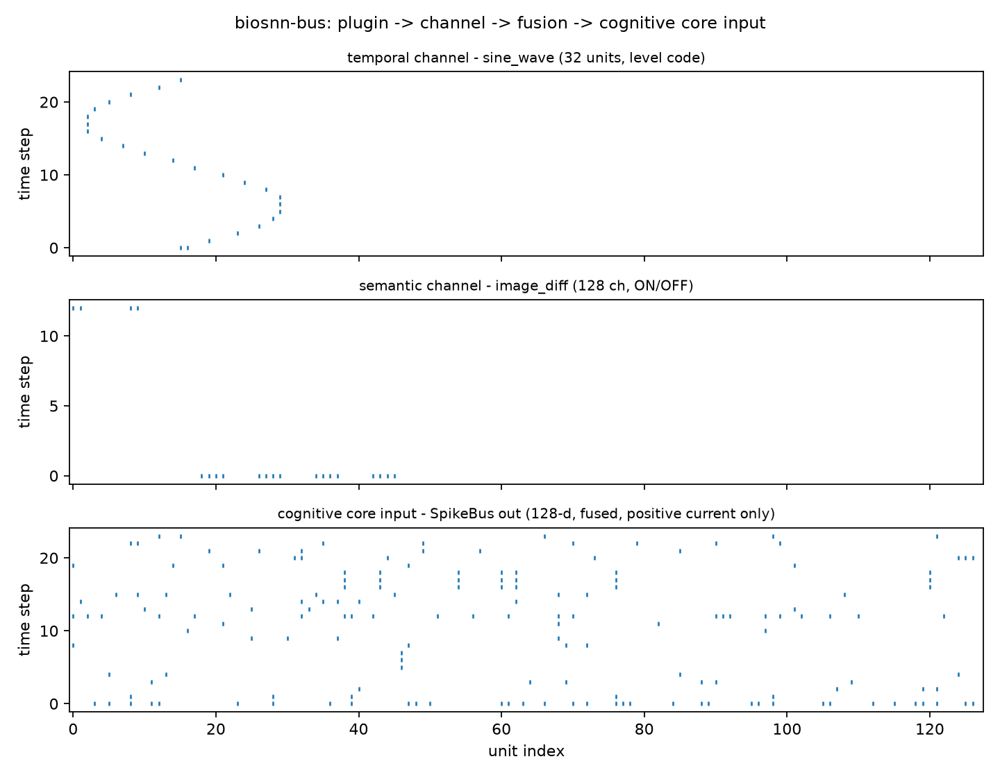

# biosnn-bus

[BioSNN-Plug](https://github.com/lzmd-arch/BioSNN-Plug) 的**模态插件骨架库**。

它只负责一件事：**让新增模态不需要修改已有架构**。

> **这是骨架，不是认知核心。** 本库不包含任何学习规则（e-prop / R-STDP /
> 核化 IB-Hebbian）、不包含脉冲神经元模型、不依赖 GPU、不依赖 PyTorch。它提供
> 的是插件的接口契约、注册与发现机制、以及脉冲总线的接缝。

## 安装

```bash
pip install biosnn-bus

# 需要 torch 桥接时（SpikeTrain.to_torch / from_torch）
pip install "biosnn-bus[torch]"
```

要从 `main` 分支装**尚未发布**的改动（例如正在评审的修复），可以走 Git：

```bash
pip install "biosnn-bus @ git+https://github.com/lzmd-arch/BioSNN-Plug.git#subdirectory=packages/biosnn-bus"
```

只依赖 numpy。

## 快速开始

```python
import numpy as np
from biosnn_bus import ModalityPlugin, PassThroughMembrane, SpikeBus, SpikeTrain


class MyPlugin(ModalityPlugin):
    @property
    def modality_name(self) -> str:
        return "my_modality"

    @property
    def spike_dim(self) -> int:
        return 64

    def encode(self, raw_input):
        return SpikeTrain(data=np.asarray(raw_input) > 0.5, channel=self.channel)

    def get_membrane(self):
        return PassThroughMembrane()

    def decode(self, spike_output):
        return spike_output.rates


bus = SpikeBus(bus_dim=128, seed=0)
bus.register(MyPlugin())
out = bus.step({"my_modality": np.random.default_rng(0).random((10, 64))})
print(out)
```

完整可跑的版本见 [`examples/quickstart_register_plugin.py`](https://github.com/lzmd-arch/BioSNN-Plug/blob/main/examples/quickstart_register_plugin.py)，
以及 [Colab notebook](https://colab.research.google.com/github/lzmd-arch/BioSNN-Plug/blob/main/examples/quickstart_register_plugin.ipynb)（无 GPU 可跑）。

它跑出来就是下面这张图——一维正弦信号走时间通道（32 个单元的水平编码），8×8 的亮度变化序列走
语义通道（128 通道 ON/OFF），最下面那条是融合、投影之后**真正送进认知核心的输入**：



图内的标签是英文：默认字体没有中文字形，中文标签会渲染成方块。图**只有这一份真相源**——
[`scripts/make_figures.py`](../../scripts/make_figures.py) 重跑上面那个示例、由示例自己把 PNG 落盘，
绘图代码不另抄一份。这是论文用图 F1。

## 核心概念

| 概念 | 说明 |
| :--- | :--- |
| `ModalityPlugin` | 模态插件的抽象基类：`encode` / `decode` / `get_membrane` 三方法，`modality_name` / `spike_dim` 两属性 |
| `SpikeTrain` | 形状 `(T, N)` 的脉冲序列容器，布尔（脉冲）或浮点（发放率）皆可 |
| `FusionChannel` | `temporal` / `semantic` 两条融合通道，对应计划书 §2.2 的"双通道融合" |
| `SpikeBus` | 脉冲总线：编码 → 时间对齐 → 按通道融合 → 稀疏随机投影到认知核心维度 |
| `register_plugin` | 进程内注册装饰器 |
| `discover_plugins` | 扫描第三方分发包声明的 entry points |

## 内置插件

| 插件 | 模态 | 编码 | 融合通道 |
| :--- | :--- | :--- | :--- |
| `image_diff` | 图像 | DVS 式 ON/OFF 事件（帧差） | semantic |
| `mnist_pulse` | MNIST | 像素值即发放概率（伯努利） | semantic |
| `text_zscore` | 文本 | 冻结 embedding + z-score top-k 群体编码 | temporal |
| `audio_cochlea` | 音频 | 对数频带分解 + 发放率 | temporal |

## 第三方插件怎么接入

在你的包里声明 entry point，**不需要修改 BioSNN-Plug 任何一行代码**：

```toml
# 你的包的 pyproject.toml
[project.entry-points."biosnn_bus.plugins"]
audio = "my_pkg.plugins.audio:AudioPlugin"
```

用户侧扫描并接入。下面这段可以直接跑——即使一个第三方插件都没装：

```python
from biosnn_bus import SpikeBus, discover_plugins, get_plugin, list_plugins
from biosnn_bus.plugins import DiffImagePlugin

discover_plugins()  # 扫描第三方分发包声明的插件；一个都没装也不会报错
print(list_plugins())  # 内置示例插件在 import 时已注册进注册表

bus = SpikeBus(bus_dim=128, seed=0)
bus.register(get_plugin("image_diff")())  # 等价于 bus.register(DiffImagePlugin())
print(bus)
```

## 骨架的边界

脉冲总线当前的默认融合策略是**平凡的拼接**（`ConcatenateFusion`），**不是**计划书
§2.2 描述的 TAAF 时间注意力引导融合——后者是第二阶段的研究任务。总线已经把
`FusionStrategy` 协议和双通道路由留好，替换策略不会改动调用方代码。

理由见 [ADR-0001](https://github.com/lzmd-arch/BioSNN-Plug/blob/main/docs/adr/ADR-0001-skeleton-as-separate-library.md)。

## SpikeBus 规范 v0.1（宿主契约，2026-10-29 草案）

**范围**：插件作者与宿主（产品）之间的接缝；**不**标准化学习机制、神经元模型或调度策略。

| 宿主原语 | 语义 | 参数 | 返回 / 错误 |
| :--- | :--- | :--- | :--- |
| `inject(modality, raw, t=None)` | 把一个模态的原始输入推进总线 | `modality: str`、`raw: Any`、`t: int \| None` | `None`；未知模态 → `UnknownModality` |
| `read_state()` | 读当前融合态的**只读快照** | — | `dict`（通道、维度、时间步）；调用方不得原地修改 |
| `wait_trigger(timeout_ms)` | 阻塞到 SNN 认为「值得行动」 | `timeout_ms ≥ 0` | `TriggerEvent(t, salience, associations)` 或超时 `None` |

**数据契约**：时间轴为整数毫秒、同一 step 内各模态对齐；脉冲为布尔，浮点发放率必须在
`[0, 1]`；禁止 NaN/inf；融合后维度恒为 `bus_dim`。

**插件契约**：`encode` / `decode` / `get_membrane` 三方法，`modality_name` 唯一、
`spike_dim ≥ 1`；不依赖 torch（`[torch]` 只做可选桥接）。

**版本**：语义化版本；`v0.x` 允许破坏性变更并须在 release notes 写明；宿主应固定 minor。

**一致性测试（conformance，进 CI）**：C1 注册后 `step` 返回 `(bus_dim,)`；C2 未知模态报错；
C3 时间对齐；C4 维度恒定；C5 快照只读。

**读写边界（三面矩阵，2026-10-30 定稿）**：开放度 = 信任边界——**谁为写入负责，谁才有写权**。

| 面 | 谁可以写 | 约束 |
| :--- | :--- | :--- |
| 感知面 | 任何插件（开放写"感觉"） | TAAF 融合 + 逐调用审计 + **插件默认关** |
| 记忆面 | **只有动力学核**（宿主与 LLM 都不能直写） | 外部只能 `propose`，经两阶段队列 + 巩固门控消费 |
| 知识面 | 最大开放（文档、规范、数据） | 但机制核心闭源，不在总线契约内 |

对 MCP 的三句话：**只读是立场**（LLM 永不直写）、**propose 是阀门**（两阶段队列）、
**总线是唯一的门**。命名纪律：**不会真实写入的工具不得叫 `write_*`**（见 ADR-0027）。

**编码署名**：维度无关的文本编码（z-score 标准化 top-k 群体编码）来自 EMBER 组
（Savage, 2026, arXiv:2604.12167）；本仓库的 `text_zscore` 是该编码的**后续实现并已引用**，
归因方向 EMBER → BioSNN。本规范中涉及该编码的描述，署名归 EMBER 组。

## 许可证

Apache-2.0。文档采用 CC-BY 4.0。
